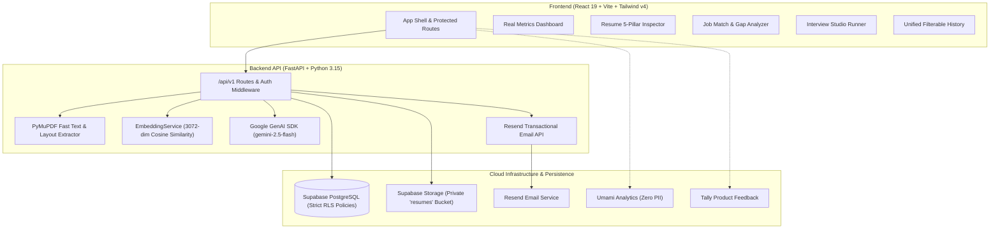

# CareerPilot AI — Intelligent Career Readiness Platform

[](https://fastapi.tiangolo.com)
[](https://react.dev)
[](https://tailwindcss.com)
[](https://ai.google.dev)
[](https://supabase.com)
[](LICENSE)

> **CareerPilot AI** is a production-ready, evidence-grounded career preparation platform designed for university students and early-career candidates. It replaces inflated scores and generic advice with verifiable excerpt citations, mathematical dual-metric job matching, and real-time interview evaluations across correctness, completeness, clarity, and reasoning.

---

## 🏛️ System Architecture



---

## ✨ Key Features & Pillars

### 1. Evidence-Grounded Resume Analysis (5 Pillars)
- **Local Text Extraction**: PyMuPDF extracts text, headings, and formatting without uploading unverified binaries to third parties.
- **Strict PDF Gatekeeping**: Rejects files > 5MB, verifies `%PDF` magic bytes, and flags unreadable scanned PDFs (requires minimum 150 characters of selectable text).
- **5-Pillar Rubric Audit**:
  - *Skills Depth & Technical Rigor* (0–20 pts)
  - *Project Complexity & Scope* (0–20 pts)
  - *Impact, Results & Quantification* (0–20 pts)
  - *ATS Readability & Layout Formatting* (0–20 pts)
  - *Career Clarity & Role Targeting* (0–20 pts)
- **Zero Hallucination Proof**: Every score deduction and praise includes a verbatim quoted excerpt from the candidate's actual resume text.

### 2. Dual-Metric Job Description Matching & Gap Analysis
- **Dual Evaluation System**: Separates **Semantic Alignment** (3072-dim vector cosine similarity) from **Explicit Skill Coverage** (keyword match percentage).
- **Gemini Granular Skill Extraction**: Automatically tags extracted skills as *Required Core*, *Preferred*, or *Soft Skills*.
- **Gap Recommendations**: Pinpoints exactly what skills are missing from the resume and outputs actionable 3-step remedies.

### 3. Interactive Interview Studio & Turn-by-Turn Evaluation
- **Role-Targeted Generation**: Generates customized technical, behavioral, or HR questions calibrated to the candidate's target job role and experience level.
- **Turn-by-Turn Rubric Feedback**: Evaluates candidate answers across 4 distinct pillars:
  - *Correctness*: Factual and technical accuracy
  - *Completeness*: Addressing all components of the prompt
  - *Clarity*: Structure, conciseness, and articulation
  - *Reasoning*: Architectural depth, trade-off analysis, and problem-solving methodology
- **Session Summaries**: Computes candidate average score, highlighted strengths, and constructive growth areas.

### 4. Real Metrics Dashboard & Filterable History
- **Composite Career Readiness Score**: Weighted formula: `40% Latest Resume Rubric + 30% Avg Job Coverage + 30% Interview Score`.
- **Zero Mock Metrics**: Real-time aggregation of stored database records across resumes, job matches, and interview sessions.
- **Transactional Email Reports**: Server-side report summaries delivered directly to candidate emails via Resend.
- **Unified Activity History**: Reverse-chronological timeline with search filtering, category tabs, and secure deletion.

---

## 🔒 Security, Isolation & Privacy Guarantees

1. **Row-Level Security (RLS)**: Every Supabase table (`profiles`, `resumes`, `resume_analyses`, `job_descriptions`, `job_matches`, `interview_sessions`, `interview_questions`) enforces `auth.uid() = user_id`. Cross-user data access is physically rejected at the database level.
2. **Private Storage Buckets**: Uploaded resume PDFs reside in a private bucket accessible only via short-lived signed URLs.
3. **No PII Tracking**: Umami analytics collects aggregate traffic and interactions with zero personal information, IP hashing, and no cookies.
4. **IDOR Defense**: All API routes strictly verify JWT `sub` claims before reading, updating, or deleting any candidate asset.

---

## 🛠️ Technology Stack

| Layer | Technologies |
|---|---|
| **Frontend** | React 19, Vite 8, TypeScript, Tailwind CSS v4, Lucide Icons, React Router v7 |
| **Backend** | Python 3.15, FastAPI, Uvicorn, Pydantic v2, PyMuPDF (fitz) |
| **Artificial Intelligence** | Google GenAI SDK (`gemini-2.5-flash`), `gemini-embedding-001` (3072 dimensions) |
| **Database & Auth** | Supabase PostgreSQL, Supabase Auth (JWT), Supabase Storage |
| **Email & Analytics** | Resend API, Umami Analytics, Tally Feedback Forms |
| **Testing** | Pytest, Pytest-Asyncio, HTTPX, Vite Build Checker |

---

## 🚀 Local Development Quickstart

### 1. Prerequisites
- **Node.js** v20+ and `npm`
- **Python** 3.11+ (tested on Python 3.15)
- **Supabase Account** (or local Supabase CLI)
- **Google Gemini API Key** (from [Google AI Studio](https://aistudio.google.com))

### 2. Clone Repository
```bash
git clone https://github.com/your-username/careerpilot-ai.git
cd careerpilot-ai
```

### 3. Backend Setup
```bash
# Navigate to backend directory
cd backend

# Create and activate virtual environment
python -m venv venv
# Windows:
.\venv\Scripts\Activate.ps1
# macOS/Linux:
# source venv/bin/activate

# Install dependencies
pip install -r requirements.txt

# Create .env file
cp .env.example .env
```

Configure your `backend/.env`:
```env
ENVIRONMENT=development
DEBUG=true
SUPABASE_URL=https://your-supabase-project.supabase.co
SUPABASE_ANON_KEY=your-supabase-anon-key
SUPABASE_SERVICE_ROLE_KEY=your-supabase-service-role-key
SUPABASE_JWT_SECRET=your-supabase-jwt-secret
GEMINI_API_KEY=your-gemini-api-key
RESEND_API_KEY=your-resend-api-key
RESEND_FROM_EMAIL="CareerPilot AI <onboarding@resend.dev>"
```

Start the FastAPI backend server:
```bash
$env:PYTHONPATH='backend'
uvicorn app.main:app --reload --port 8000
```
Backend Swagger docs will be available at `http://localhost:8000/docs`.

### 4. Frontend Setup
```bash
# In a separate terminal, navigate to frontend
cd frontend

# Install dependencies
npm install

# Create .env file
cp .env.example .env
```

Configure your `frontend/.env`:
```env
VITE_API_BASE_URL=http://localhost:8000
VITE_SUPABASE_URL=https://your-supabase-project.supabase.co
VITE_SUPABASE_ANON_KEY=your-supabase-anon-key
VITE_TALLY_FEEDBACK_URL=https://tally.so/r/w8Z4oE
```

Start Vite development server:
```bash
npm run dev
```
Open `http://localhost:5173` in your browser.

---

## 🧪 Testing & Verification

Run the comprehensive automated test suite (32 tests across 7 test modules):
```bash
# Run all backend tests with pythonpath configured
.\backend\venv\Scripts\pytest backend\tests -o pythonpath=backend -v
```

Run frontend production build verification:
```bash
cd frontend
npm run build
```

---

## 🚢 Deployment

### Frontend (Vercel)
The project includes a ready-to-deploy `vercel.json` configuring SPA rewrite rules and HTTP security headers:
1. Connect your GitHub repository to [Vercel](https://vercel.com).
2. Configure **Root Directory**: `frontend` (or use root with `vercel.json`).
3. Set Environment Variables:
   - `VITE_API_BASE_URL`: URL of your deployed backend (e.g. `https://careerpilot-api.onrender.com`).
   - `VITE_SUPABASE_URL`: Your Supabase URL.
   - `VITE_SUPABASE_ANON_KEY`: Your Supabase Anon Key.
4. Deploy!

### Backend (Render)
The project includes `render.yaml` for automated deployment on [Render](https://render.com):
1. Create a new **Web Service** from GitHub on Render.
2. Select **Python** runtime with build command:
   ```bash
   pip install --upgrade pip && pip install -r requirements.txt
   ```
3. Set start command:
   ```bash
   uvicorn app.main:app --host 0.0.0.0 --port $PORT
   ```
4. Configure environment variables in the Render dashboard matching `backend/.env`.

---

## 📄 License
This project is open-source under the [MIT License](LICENSE).
